# VS Code Themes for Windows Terminal

把 VS Code 上最受欢迎的配色主题移植到 Windows Terminal。

**9 个热门 VS Code 主题的 21 套配色 + Chinolor 2 套 = 23 套**，包含浅色与深色变体，全部来自各主题官方扩展的配色定义。

<p align="center">
  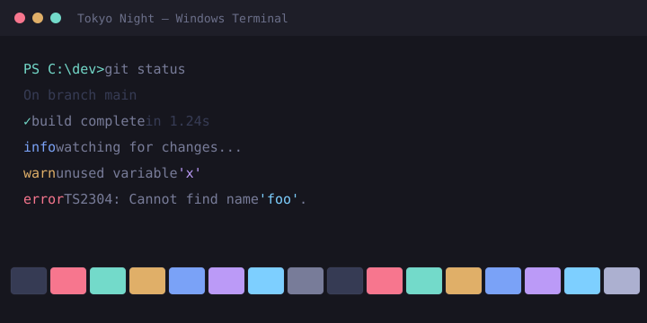
  &nbsp;
  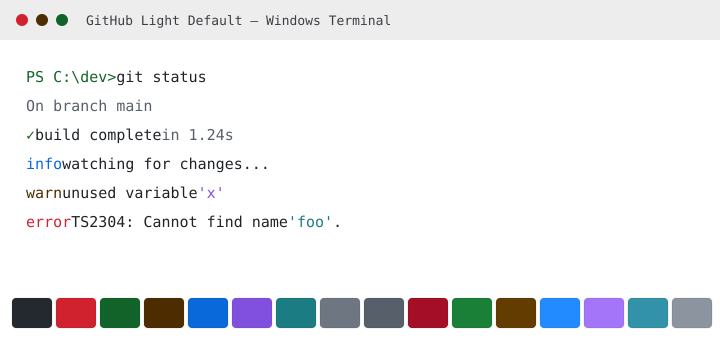
</p>

> 本项目由 [Chinolor](https://marketplace.visualstudio.com/items?itemName=iwyvi.chinolor) 的 Windows Terminal 移植延伸而来，Chinolor 的两套配色也包含在内。

## 包含的配色

| 主题 | 配色方案 | 来源 | 许可证 |
| --- | --- | --- | --- |
| GitHub Theme | GitHub Dark Default / GitHub Dark Dimmed / GitHub Light Default | [GitHub.github-vscode-theme](https://marketplace.visualstudio.com/items?itemName=GitHub.github-vscode-theme) | MIT |
| One Dark Pro | One Dark Pro / One Dark Pro Darker / One Dark Pro Night Flat | [zhuangtongfa.Material-theme](https://marketplace.visualstudio.com/items?itemName=zhuangtongfa.Material-theme) | MIT |
| Dracula Theme Official | Dracula Theme / Dracula Theme Soft | [dracula-theme.theme-dracula](https://marketplace.visualstudio.com/items?itemName=dracula-theme.theme-dracula) | MIT |
| Atom One Dark Theme | Atom One Dark | [akamud.vscode-theme-onedark](https://marketplace.visualstudio.com/items?itemName=akamud.vscode-theme-onedark) | MIT |
| Ayu | Ayu Dark / Ayu Mirage / Ayu Light | [teabyii.ayu](https://marketplace.visualstudio.com/items?itemName=teabyii.ayu) | MIT |
| Winter is Coming Theme | Winter is Coming (Dark Blue) / (Dark Black) / (Light) | [johnpapa.winteriscoming](https://marketplace.visualstudio.com/items?itemName=johnpapa.winteriscoming) | MIT |
| Night Owl | Night Owl / Night Owl Light | [sdras.night-owl](https://marketplace.visualstudio.com/items?itemName=sdras.night-owl) | MIT |
| Tokyo Night | Tokyo Night / Tokyo Night Storm / Tokyo Night Light | [enkia.tokyo-night](https://marketplace.visualstudio.com/items?itemName=enkia.tokyo-night) | MIT |
| SynthWave '84 | SynthWave '84 | [RobbOwen.synthwave-vscode](https://marketplace.visualstudio.com/items?itemName=RobbOwen.synthwave-vscode) | MIT |
| Chinolor（附加） | Chinolor Dark / Chinolor Light | [iwyvi.chinolor](https://marketplace.visualstudio.com/items?itemName=iwyvi.chinolor) | MIT |

## 配色预览

### GitHub Theme

| GitHub Dark Default | GitHub Dark Dimmed | GitHub Light Default |
| :---: | :---: | :---: |
| 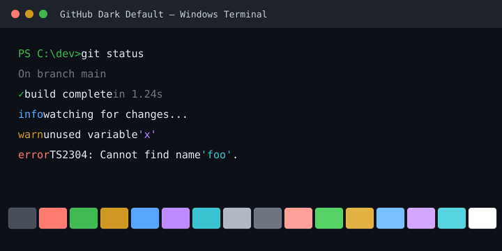 | 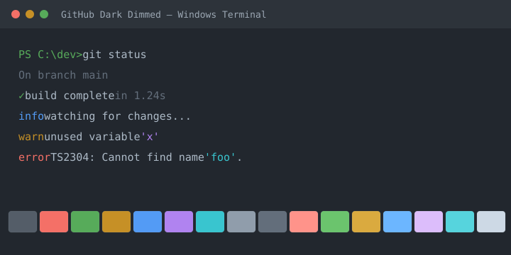 |  |

### One Dark Pro

| One Dark Pro | One Dark Pro Darker | One Dark Pro Night Flat |
| :---: | :---: | :---: |
| 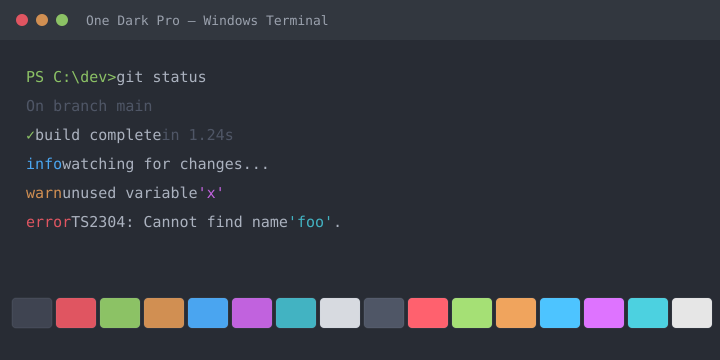 | 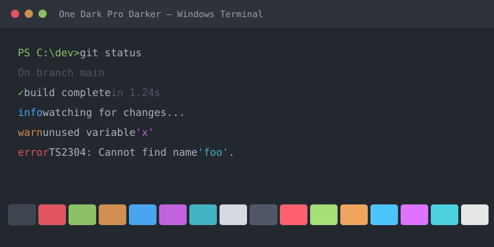 | 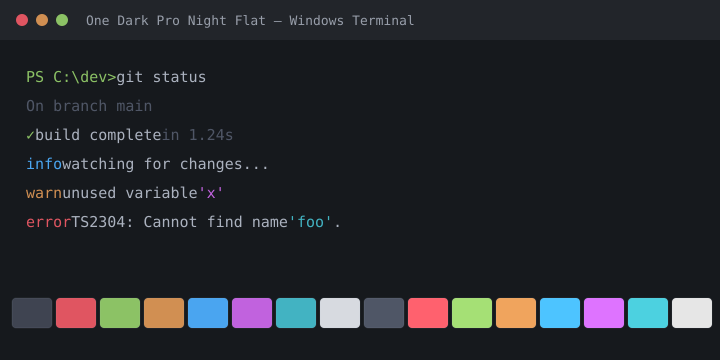 |

### Dracula Theme

| Dracula Theme | Dracula Theme Soft |
| :---: | :---: |
|  | 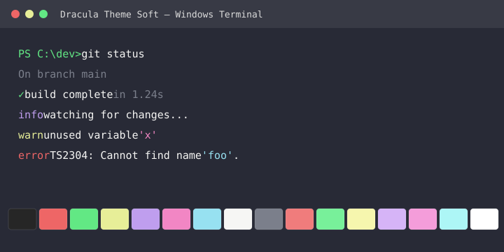 |

### Atom One Dark

| Atom One Dark |
| :---: |
| 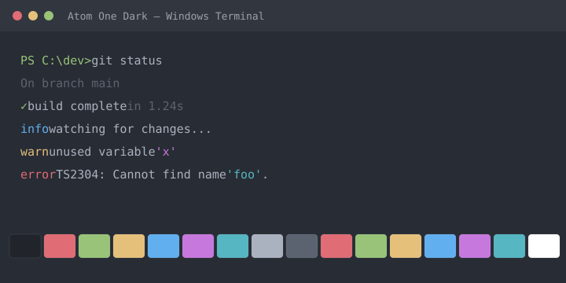 |

### Ayu

| Ayu Dark | Ayu Mirage | Ayu Light |
| :---: | :---: | :---: |
| 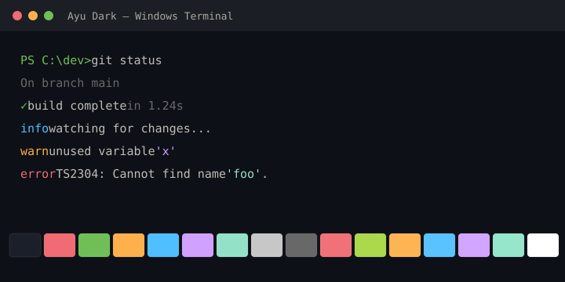 | 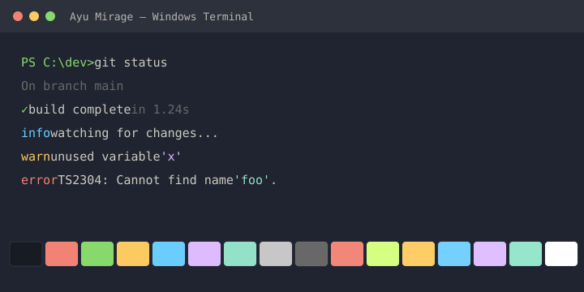 | 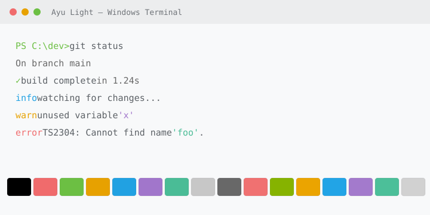 |

### Winter is Coming

| Dark Blue | Dark Black | Light |
| :---: | :---: | :---: |
| 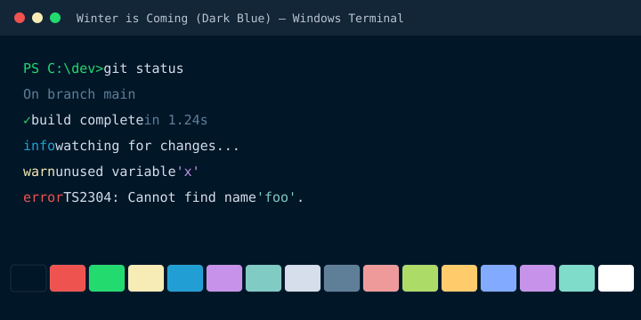 | 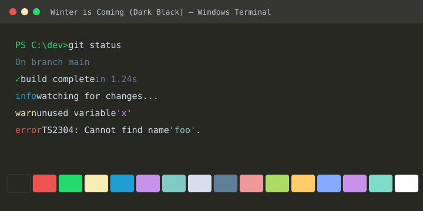 | 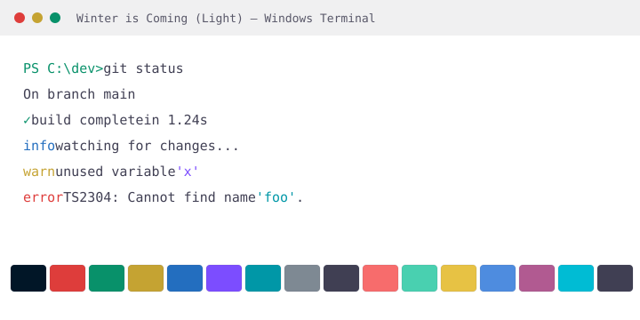 |

### Night Owl

| Night Owl | Night Owl Light |
| :---: | :---: |
| 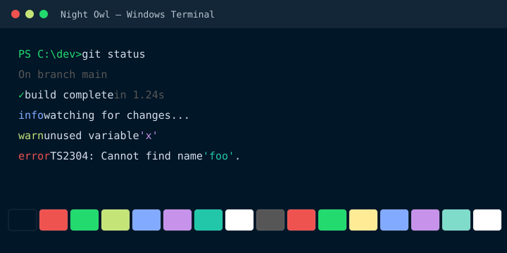 | 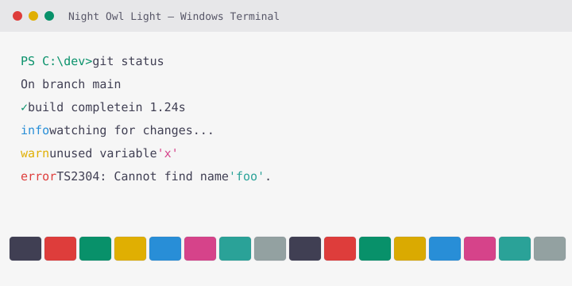 |

### Tokyo Night

| Tokyo Night | Tokyo Night Storm | Tokyo Night Light |
| :---: | :---: | :---: |
|  | 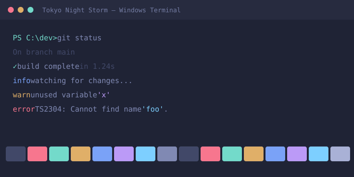 | 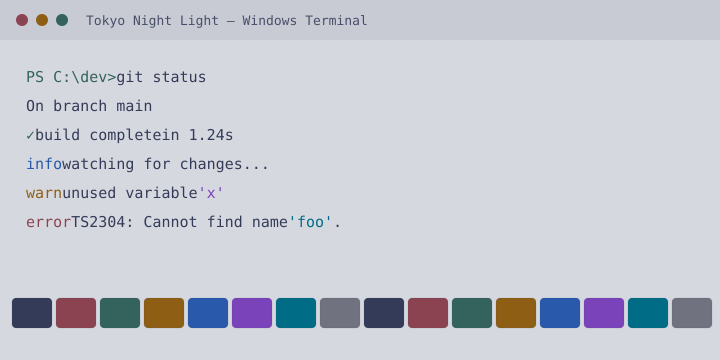 |

### SynthWave '84

| SynthWave '84 |
| :---: |
| 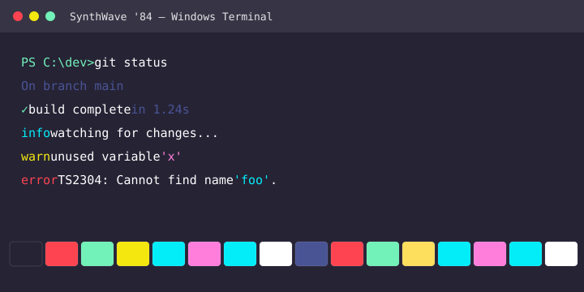 |

### Chinolor

| Chinolor Dark | Chinolor Light |
| :---: | :---: |
| 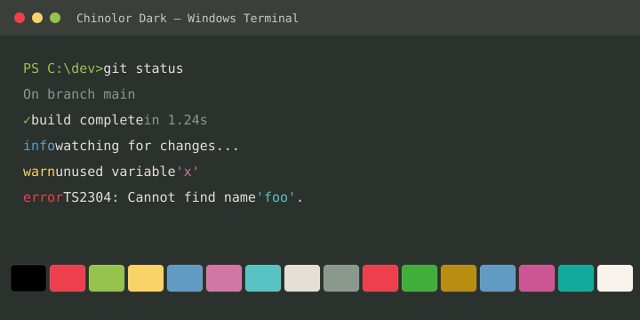 | 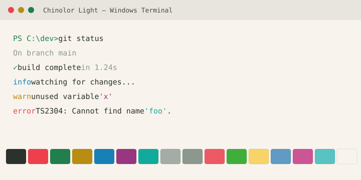 |

只需要 Chinolor 的话，也可以直接使用独立的 [chinolor-windows-terminal.json](chinolor-windows-terminal.json)。

## 安装

要求：Windows 10/11，已安装 Windows Terminal（Store 版、Preview 版或解压版均可）。

```powershell
git clone https://github.com/mingqiaopeng/vscode-themes-for-windows-terminal.git
cd vscode-themes-for-windows-terminal
powershell -ExecutionPolicy Bypass -File .\install.ps1
```

脚本会：

1. 自动定位 Windows Terminal 的 `settings.json`（Store、Preview、非 Store 安装及 Scoop 均可）。
2. 先备份为 `settings.json.bak-vscode-themes-<时间戳>`。
3. 把 `schemes.json` 中的配色合并进 `schemes` 数组；同名配色会被更新，其它配色和设置保持不变。
4. 写入前做一次 JSON 校验，校验失败会直接中止，不修改原文件。

常用参数：

```powershell
# 只预览将安装哪些配色，不写入
.\install.ps1 -DryRun

# 卸载本项目安装的配色（按名称移除，不影响其它配色）
.\install.ps1 -Uninstall

# 手动指定 settings.json
.\install.ps1 -SettingsPath "D:\path\to\settings.json"
```

安装后打开 Windows Terminal 的设置（`Ctrl+,`）→ **外观 / Appearance** → **配色方案 / Color scheme** 即可选择。终端会自动重载设置，无需重启。

## 使用

给所有配置文件设置同一套配色：在 `profiles.defaults` 中设置：

```json
"profiles": {
  "defaults": {
    "colorScheme": "Tokyo Night"
  }
}
```

让浅色/深色自动跟随 Windows Terminal 主题：

```json
"profiles": {
  "defaults": {
    "colorScheme": {
      "dark": "Tokyo Night",
      "light": "Tokyo Night Light"
    }
  }
}
```

也可以只给某个 profile 设置：

```json
{
  "name": "PowerShell",
  "colorScheme": "One Dark Pro"
}
```

## 配色是如何提取的

所有颜色取自各主题官方扩展的 theme JSON（版本见下表），不是在终端里目测取色：

| 主题 | 扩展版本 |
| --- | --- |
| GitHub Theme | 6.3.5 |
| One Dark Pro | 3.20.3 |
| Dracula Theme Official | 2.25.1 |
| Atom One Dark Theme | 2.3.0 |
| Ayu | 1.5.0 |
| Winter is Coming Theme | 1.5.0 |
| Night Owl | 2.1.1 |
| Tokyo Night | 1.1.2 |
| SynthWave '84 | 0.1.20 |
| Chinolor | 0.2.20 |

映射规则：

- 16 个 ANSI 色优先取主题的 `terminal.ansi*`。
- `background` / `foreground` 优先取 `terminal.background` / `terminal.foreground`，缺失时回退到编辑器背景/前景。
- `cursorColor` 取终端或编辑器光标色，`selectionBackground` 取终端/编辑器选区色。
- 半透明颜色会与背景合成为不透明色；若选区色与背景过近，会适度增强以保证在终端里可见。
- Atom One Dark 扩展本身没有 `terminal.ansi*`，使用该主题 token 中的经典 One Dark 调色板补齐。
- SynthWave '84 缺少 black/white/brightBlack/brightWhite，使用其背景、前景与边框色补齐。

## 卸载

```powershell
.\install.ps1 -Uninstall
```

脚本只移除 `schemes.json` 中列出的同名配色，不会动其它配色或 profile 设置，并同样会先备份。

## 手动安装

不想运行脚本时，打开 Windows Terminal 的 `settings.json`（设置页左下角“打开 JSON 文件”），把 `schemes.json` 数组中的对象复制到顶层的 `"schemes": [ ... ]` 里即可。

## 致谢与致敬

这个项目只是把别人已经做得很好的配色搬到 Windows Terminal。真正的设计功劳属于每一位原作者：

- **GitHub Theme** — Primer
- **One Dark Pro** — Binaryify
- **Dracula Theme** — Dracula Theme 团队
- **Atom One Dark** — Mahmoud Ali
- **Ayu** — Ike Kurghinyan
- **Winter is Coming** — John Papa
- **Night Owl** — Sarah Drasner
- **Tokyo Night** — Enkia
- **SynthWave '84** — Robb Owen
- **Chinolor** — iwyvi

感谢他们创造出这些经典、耐看且各有性格的配色，也感谢他们选择 MIT 许可，让社区可以自由使用和再创作。没有这些原创工作，就不会有这个主题包。

配色版权归各主题作者所有，本项目仅做格式转换与终端适配。完整的版权声明见 [THIRD-PARTY-NOTICES.md](THIRD-PARTY-NOTICES.md)。

本项目的脚本、README 与预览图使用 MIT 许可，见 [LICENSE](LICENSE)。

本项目与 Microsoft、Visual Studio Code 及各主题作者无隶属关系；主题名称与商标归各自所有者。

## 重新生成预览图

```powershell
node .\tools\generate-previews.mjs
```

预览图由 `schemes.json` 生成，修改配色后重新运行即可。
